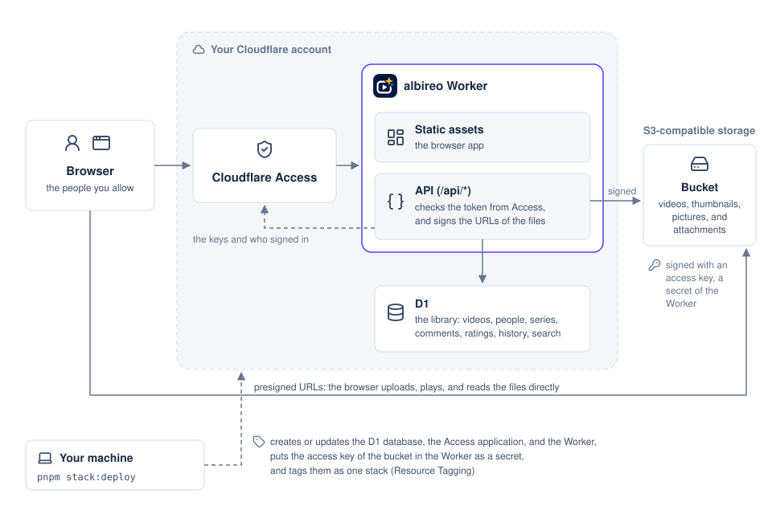

<h1 align="center">
  <picture>
    <source media="(prefers-color-scheme: dark)" srcset="images/albireo-wordmark-dark.png">
    
  </picture>
</h1>

<p align="center">albireo is a private video library built on Cloudflare Workers.</p>

<p align="center">
  <a href="https://github.com/etak64n/albireo/actions/workflows/ci.yml"></a>
  <a href="https://github.com/etak64n/albireo/actions/workflows/pages.yml"></a>
  <a href="https://github.com/etak64n/albireo/releases"></a>
  <a href="https://github.com/etak64n/albireo/blob/main/LICENSE"></a>
</p>

<p align="center">
  <a href="https://etak64n.github.io/albireo/">Live Demo</a>
  · <a href="https://etak64n.github.io/albireo/docs/">Docs</a>
  · <a href="#quickstart">Quickstart</a>
  · <a href="https://github.com/etak64n/albireo/releases">Releases</a>
  · <a href="https://github.com/etak64n/albireo/issues">Issues</a>
</p>

[](https://etak64n.github.io/albireo/)

The people you allow sign in with Cloudflare Access, then upload, watch, rate, and comment on videos, and attach files such as slides to them. Videos and attached files stay in your S3-compatible bucket as you uploaded them, and the browser sends and reads them directly, so their bytes never pass through the Worker. Each person chooses English or Japanese as the language of the app.

## Architecture



`pnpm stack:deploy` creates three resources as one stack.

| Resource | Role |
| --- | --- |
| **D1 database** | Holds the library: videos, people, series, comments, ratings, watch history, and a search index. |
| **Access application** | Allows only the people with the configured email addresses, and shows the configured login methods on the sign-in page. |
| **Worker** | Serves the browser app and the API on your domain. |

The bucket stays outside the stack, because it can be at any S3-compatible provider.

## Quickstart

To try albireo on your machine without a Cloudflare account or a bucket, see [Try it locally](https://etak64n.github.io/albireo/docs/getting-started/try-locally/).

### Prerequisites

| Requirement | Details |
| --- | --- |
| **Cloudflare account** | Holds the zone of your domain. |
| **Zero Trust organization** | In that Cloudflare account; runs the sign-in of Cloudflare Access. |
| **S3-compatible bucket** | Supports Signature Version 4 presigned URLs, multipart uploads, and CORS. |
| **Access key** | Has permission to read and write objects in that bucket only. |
| **Node.js** | 22.23+, 24.22+, or 26.12+. |
| **pnpm** | 12.16+. |

### 1. Clone and Install

Clone the repository, check out the `latest` release tag, and install the dependencies.

```bash
# Clone the repository, switch to the latest release, and install the dependencies
git clone https://github.com/etak64n/albireo.git
cd albireo
git checkout latest
pnpm install
```

### 2. Configure

Copy `albireo.config.example.ts` to `albireo.config.ts` and replace every value.

```bash
# Create your settings from the example. Git ignores albireo.config.ts.
cp albireo.config.example.ts albireo.config.ts
```

This is `albireo.config.example.ts`:

```ts
// Settings of this albireo deployment.
//
// Copy this file to albireo.config.ts and replace every value. Git ignores
// albireo.config.ts. Storage access keys are secrets, so they do not go here:
// see .env.example.

import { defineAlbireoConfig } from "./config/settings.ts";

export default defineAlbireoConfig({
  // Cloudflare account that owns the Worker, the domain, and the D1 database
  accountId: "0123456789abcdef0123456789abcdef",
  workerName: "albireo",
  // D1 database that stores the list of videos. `pnpm stack:deploy` creates it
  // when the account has no database of this name.
  database: {
    name: "albireo",
  },
  // Lifetime of the signed URLs that the browser uses to upload and play videos.
  // The player gets a new URL when one expires, but a lifetime longer than
  // your longest video avoids that pause.
  signedUrlTtlSeconds: 21600,
  // People who can edit every video and every series, by the email that Cloudflare
  // Access reports. Everyone else edits only the videos and series of their own.
  admins: ["admin@example.com"],
  // How the library looks: its name, and the theme folder with theme.css (colors,
  // corners, shadows, and fonts) and logo.svg. albireo includes ./themes/light and
  // ./themes/dark, and a theme folder of your own works the same way.
  appearance: {
    siteName: "albireo",
    theme: "./themes/light",
  },
  production: {
    domain: "videos.example.com",
    storage: {
      type: "s3",
      endpoint: "https://s3.example.com",
      region: "us-east-1",
      bucket: "albireo-videos",
      urlStyle: "path",
    },
    // Cloudflare Access, which lets only these people open albireo. pnpm stack:deploy
    // reads the team domain from the Zero Trust organization of the account.
    access: {
      // The emails that may sign in. They include every admin.
      allow: ["admin@example.com"],
      // The login methods that the sign-in page offers: "all" for every login method of your
      // Zero Trust organization, or a list of their types, such as ["passkeys", "onetimepin"]
      loginMethods: "all",
    },
  },
  // `cf dev` serves albireo on localhost without Cloudflare Access.
  // "local-r2" keeps videos in a simulated R2 bucket on this machine and needs
  // no keys. To develop against real storage, write an "s3" storage here as in
  // production, with a bucket that holds no production videos.
  development: {
    // Cloudflare Access does not run on this machine, so cf dev signs you in as this email.
    signInAs: "admin@example.com",
    storage: {
      type: "local-r2",
    },
  },
});
```

### 3. Set CORS on the Bucket

The bucket needs CORS settings because the browser uploads files to the bucket and reads attachments from it on another origin. Replace `https://videos.example.com` in `examples/bucket-cors.json` with your domain, then apply the rules to the bucket.

```bash
# Apply the CORS rules to the bucket with the AWS CLI.
# --endpoint-url                  : the S3-compatible API of your storage service (production.storage.endpoint)
# --bucket                        : the bucket that holds the videos (production.storage.bucket)
# --cors-configuration file://... : the rules to apply, read from the file
aws s3api put-bucket-cors \
  --endpoint-url https://s3.example.com \
  --bucket albireo-videos \
  --cors-configuration file://examples/bucket-cors.json
```

### 4. Add the Access Key

Write the access key for the production bucket in `.env.production`. `pnpm stack:deploy` uploads these values as Worker secrets, so they stay out of `albireo.config.ts`.

```dotenv
# .env.production: the access key of the production bucket
S3_ACCESS_KEY_ID=your-access-key-id
S3_SECRET_ACCESS_KEY=your-secret-access-key
```

### 5. Deploy

Sign the Cloudflare CLI in to your account and deploy the stack.

```bash
# Sign the Cloudflare CLI in to your account
pnpm exec cf auth login

# Create or update the D1 database, the Access application, and the Worker
pnpm stack:deploy
```

See [Configuration](https://etak64n.github.io/albireo/docs/settings/configuration/) for every setting and [Deploy](https://etak64n.github.io/albireo/docs/getting-started/deploy/) for the full deployment guide.

## Updating and Uninstalling

Before you update, check the [release notes](https://github.com/etak64n/albireo/releases) for changes that your settings need. Then fetch the tags, switch to `latest`, install the dependencies, and deploy the stack again.

```bash
# Fetch the tags of new releases, and switch to the latest release
git fetch --tags --force
git checkout latest

# Install the dependency versions of that release
pnpm install

# Apply the new migrations, then deploy the new code
pnpm stack:deploy
```

To uninstall, run `pnpm stack:delete`. It deletes the Worker, the Access application, and the D1 database, while the videos stay in the bucket.

```bash
# List the resources of the stack, and delete them after you type the stack name
pnpm stack:delete
```
