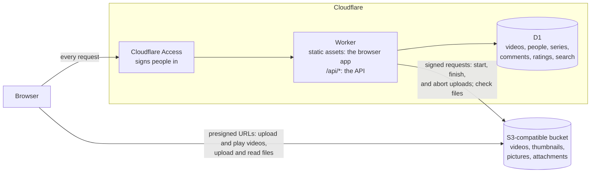
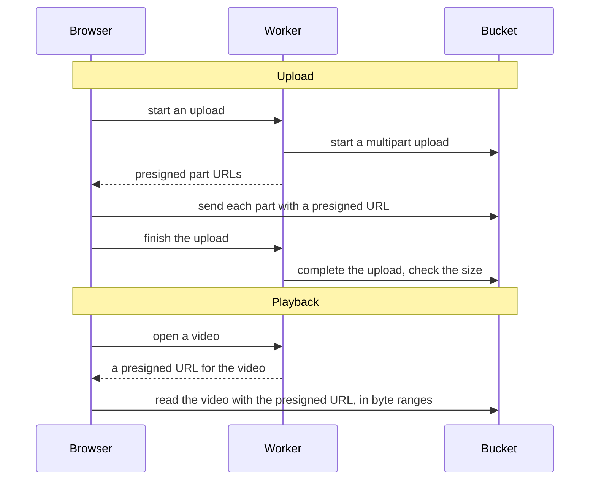
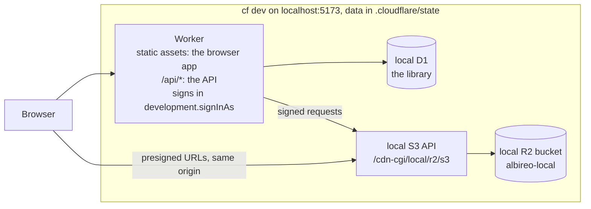

# albireo

albireo is a private video library that runs on Cloudflare Workers and keeps videos in S3-compatible object storage.
The people you allow sign in with Cloudflare Access, then upload, watch, rate, and comment on videos, and attach files such as slides to them.
This README explains what albireo does, how it works, how to run it on your machine, and how to deploy it to your own domain.

## Contents

- [albireo](#albireo)
  - [In short](#in-short)
  - [How it works](#how-it-works)
    - [Architecture in production](#architecture-in-production)
    - [Parts](#parts)
    - [The path of a video](#the-path-of-a-video)
    - [Design choices](#design-choices)
  - [Features](#features)
    - [What albireo does](#what-albireo-does)
    - [People and permissions](#people-and-permissions)
    - [Upload](#upload)
    - [Home and lists](#home-and-lists)
    - [Search](#search)
    - [Series](#series)
    - [Play](#play)
    - [Ratings](#ratings)
    - [Comments](#comments)
    - [Attachments](#attachments)
    - [Channels](#channels)
    - [Limits](#limits)
    - [What albireo does not do](#what-albireo-does-not-do)
  - [Try it locally](#try-it-locally)
  - [Deploy](#deploy)
    - [What you need](#what-you-need)
    - [The stack](#the-stack)
    - [Steps](#steps)
    - [Update a deployment](#update-a-deployment)
    - [Delete a deployment](#delete-a-deployment)
  - [Local development](#local-development)
    - [Architecture with cf dev](#architecture-with-cf-dev)
    - [Sign-in on localhost](#sign-in-on-localhost)
    - [Development storage](#development-storage)
    - [Local data](#local-data)
    - [Checks](#checks)
  - [Releases](#releases)
  - [Configuration reference](#configuration-reference)
    - [Example](#example)
    - [Settings](#settings)
    - [Themes](#themes)
  - [Scripts](#scripts)
  - [Project layout](#project-layout)
  - [License](#license)

## In short

- albireo is one Cloudflare Worker that serves a browser app and an API. D1 holds the library: videos, people, series, comments, ratings, watch history, attachments, and a search index.
- Videos and attached files stay in your S3-compatible bucket as you uploaded them. The browser sends and reads them directly, so their bytes never pass through the Worker.
- Cloudflare Access decides who can open the library. albireo keeps a profile for each person who signs in, but it has no passwords of its own.

A typical use is keeping your own recordings, such as meeting or lecture recordings with their slides, in one private place.

## How it works

albireo splits the work in two. The Worker answers small requests, and the browser moves the files.

### Architecture in production

The diagram shows albireo in production: the parts and the requests between them. Each arrow points from the part that sends a request.



The diagram has three paths.

1. Every request to your domain goes through Access before it reaches the Worker. This covers the pages of the browser app and the API.
2. The Worker keeps the library in D1, and it signs its own requests to the bucket.
3. The browser uploads videos, thumbnails, pictures, and attachments, and it plays and reads them, directly with presigned URLs.

A presigned URL is a URL that carries its own signature and expiry time.
With one, the browser can read or write one object in the bucket without holding the storage keys.

On your machine, albireo runs without Access and with local copies of D1 and the bucket. [Architecture with cf dev](#architecture-with-cf-dev) shows that setup.

### Parts

albireo uses four parts.

1. The Worker
2. D1
3. The bucket
4. Cloudflare Access

The Worker serves the browser app and the HTTP API.
The browser app is a React single-page app built with Vite, and Cloudflare serves it as static assets.

Only requests to `/api/*` run the Worker code, which uses the Hono framework (cloudflare.config.ts, worker/index.ts).

```ts
// cloudflare.config.ts: the browser app is static assets, and only /api/* runs the Worker
assets: {
  notFoundHandling: "single-page-application",
  runWorkerFirst: ["/api/*"],
},
```

The browser app builds on these libraries (package.json).

- Tailwind CSS v4 for the styles, Radix UI for the menus, dialogs, and sliders, and lucide-react for the icons
- Video.js 10 (@videojs/react) for the player
- react-easy-crop for cropping profile pictures
- react-pdf, @extend-ai/react-pptx, and react-markdown for the previews of attachments

D1 is Cloudflare's serverless SQLite database.
albireo keeps these tables in D1 (migrations/0001_create_videos.sql to migrations/0007_attachments.sql).

- videos: one row per video, with its title, description, size, duration, resolution, thumbnail, uploader, series, and upload state
- users: one row per person, with the email, the display name, the bio, and the picture
- series: one row per series, with its title, description, and creator
- watch_history: the videos that each person watched, with the last time
- comments and ratings: what people wrote under videos, and the stars that they gave them
- attachments: the files of each video, with their names, types, and sizes
- video_search: the full-text index of the titles and descriptions

The bucket holds the video files, their thumbnails, the profile pictures, and the attachments (worker/app.ts).

- A video goes to `videos/<ID>/original<extension>`, and its thumbnail to `thumbnails/<ID>.jpg`.
- A profile picture goes to `avatars/<user ID>.jpg`.
- An attachment goes to `attachments/<video ID>/<attachment ID>`.

The Worker signs its requests to the bucket with AWS Signature Version 4, using the aws4fetch library (worker/storage.ts).

Cloudflare Access is a Cloudflare service that signs people in before their requests reach an application.
For each request, Access adds a signed JSON Web Token in the `Cf-Access-Jwt-Assertion` header.

The Worker verifies this token on every `/api/*` request (worker/app.ts).
The check uses the public keys of your Access team and the AUD tag, the Application Audience tag that identifies one Access application (worker/access.ts).

```ts
// worker/access.ts: the Worker fetches the team's public keys from the team domain
keySet = createRemoteJWKSet(new URL("/cdn-cgi/access/certs", teamDomain));
```

### The path of a video

A multipart upload sends one file to the bucket as several parts, then joins the parts into one object.
albireo uploads every video this way. In the diagram, solid arrows are requests, and dashed arrows are answers.



Thumbnails, profile pictures, and attachments take a shorter path: one presigned PUT each, then a commit.
On the commit, the Worker checks that the file is in the bucket before albireo shows it (worker/app.ts).

### Design choices

- Video data never passes through the Worker (worker/storage.ts). The Worker starts and completes uploads and signs URLs, so it never carries the bytes of a video, however large the video is.
- D1 holds the library. The pages read D1, so they never list the bucket.
- albireo stores each file as it is. It does not transcode the file or turn it into HLS (HTTP Live Streaming), a format that splits a video into many small files. Each video stays one object, and no transcoding service is needed.
- Search runs in D1, with SQLite's full-text search FTS5 and its trigram tokenizer (migrations/0006_video_search.sql). A search library in the browser would need the titles and descriptions of every video. The trigram tokenizer finds words inside longer text, so it also works for languages that do not put spaces between words, such as Japanese.
- Previews of attachments run in the browser. The Worker cannot run converters such as LibreOffice, and online viewers would send private files to another company.
- albireo never deletes files from the bucket. Removing a picture or an attachment only unlinks it, so the access key needs no permission to delete.
- The Worker has no workers.dev address and no preview URLs (cloudflare.config.ts: `workersDev: false`, `previewUrls: false`). The only way in is the domain that Access protects.
- Every setting is required, and albireo has no default values (config/settings.ts). A deployment behaves exactly as its settings say.

A video plays if the browser supports its format, such as MP4 with H.264 video and AAC audio.

## Features

albireo keeps one library for a group of people. This section lists who can do what, what each feature does, and its limits.

### What albireo does

albireo has nine features.

1. Upload
2. Home and lists
3. Search
4. Series
5. Play
6. Ratings
7. Comments
8. Attachments
9. Channels

The rules of who can do what come first, and each feature follows in its own subsection.

### People and permissions

Everyone who signs in through Access gets a profile in D1, under the lowercase email that Access reports (worker/app.ts, worker/users.ts).
The first request creates the profile, with the part of the email before `@` as the display name.

People can do these things (worker/app.ts, header comment).

- Everyone who signs in watches every video, uploads videos, rates them, and comments on them.
- A person edits the videos that they uploaded and the series that they created.
- Admins edit every video and every series. The `admins` setting lists them by email.
- A comment can be deleted by its author, the uploader of the video, and admins.
- The uploader of a video and admins attach files to it and remove them. Everyone previews and downloads them.

An Access token without an email, such as a service token, gets a 401 answer, because albireo needs a person behind every request.

### Upload

You drop a video file anywhere on the page, or press Upload in the header to select a file (src/uploads.tsx, src/components/VideoUpload.tsx).
The file must have a `video/*` content type (worker/app.ts, `VIDEO_CONTENT_TYPE`).

- The file name without its extension becomes the title (src/lib/format.ts, `titleFromFileName`).
- Before the upload, the browser reads the duration and the resolution of the video (src/lib/media.ts).
- The browser also takes a thumbnail. The thumbnail is a JPEG frame from 10% into the video, at most 300 seconds in, at most 640 pixels wide (src/lib/media.ts).
- The browser sends 4 parts at a time and tries each part up to 3 times. You can cancel an upload, and the Worker then aborts the multipart upload (src/lib/upload.ts).
- After the last part, the Worker completes the upload. It then checks that the stored object has the size that the browser announced (worker/app.ts).
- On the page of a series, the uploaded video becomes the last episode of that series.
- The upload keeps running while you move to other pages. The browser asks before you close the tab during an upload, because closing it stops the upload (src/uploads.tsx).

### Home and lists

albireo has three lists of videos.

1. Home
2. All videos
3. History

Home (`/`) recommends videos to the person who signed in. The first video shows large, and the rest follow below it.
The recommendations come in this order, up to 48 videos (worker/app.ts, `recommend`).

1. In each series that the person is watching, the next episode that they have not watched, from the series watched last, for up to 8 series
2. The videos that they have not watched: first those of the series and the uploaders that they watched before, then the rest from the newest
3. The videos that they watched, from the one watched longest ago

All videos (`/videos`) lists every series, then every video from the newest, 48 per page (worker/videos.ts, shared/api.ts).

History (`/history`) lists the videos that the person watched, from the last watched.
The player records a video when its playback starts, and each person sees only their own history (worker/app.ts).

The sidebar on the left links to the three lists and to every series.
On screens narrower than 1024px, the sidebar hides, and the menu button in the upper left corner opens it over the page.
Dates show as YYYY/MM/DD (src/lib/format.ts, `formatDate`).

### Search

The search box in the header opens `/search?q=<query>`.
The results are the ready videos whose title or description contains every word of the query, ignoring case, with title matches first (worker/app.ts, worker/videos.ts).

- A query has 1 to 100 characters and at most 10 words. Spaces separate the words, including the wide space of Japanese text.
- Words of three or more characters use the trigram index. FTS5 orders those results by bm25, its relevance score, and counts a match in the title ten times a match in the description.
- Shorter words, such as two-character Japanese words, are too short for the index, so D1 checks them row by row.
- Triggers keep the index the same as the videos table, so new titles and edits are found at once (migrations/0006_video_search.sql).

### Series

A series groups videos as numbered episodes, such as the recordings of a course (worker/app.ts, src/pages/SeriesPage.tsx).

- Everyone sees every series, and a video belongs to at most one series.
- The episodes keep the order in which they joined. The creator of the series and admins move them up and down.
- Anyone can add their own videos to any series: from the edit form of a video, or by uploading on the page of the series.
- The creator of the series, admins, and the uploader of the video can take a video out of a series.
- When an episode ends, the next one starts. The video page also links to the previous and the next episodes.

### Play

The video page has five parts, from the top (src/pages/VideoPage.tsx).

1. The player
2. The series bar, with the previous and the next episodes, when the video is in a series
3. The title, the uploader, and the rating
4. The length, the resolution, the date, and the description
5. The attachments and the comments

The player is Video.js 10 with its neutral skin (src/components/VideoPlayer.tsx).
It changes the playback speed and plays in picture-in-picture and in full screen.

These keys work while the player has focus.

- Space or k: play and pause
- j and l, or the left and right arrows: go back or ahead 10 seconds
- m: mute
- f: full screen
- 0 to 9: jump to that tenth of the video
- < and >: slower and faster

The player takes the corners and the accent color of the theme (src/styles.css, `.albireo-player`).
Video.js loads only with a video page, so the other pages open without it.

- When playback fails, for example because the URL expired, the player asks for a new URL and resumes where it stopped.
- The player asks at most once a minute, so a broken URL cannot cause a loop (src/components/VideoPlayer.tsx).

### Ratings

Each person gives a video 1 to 5 stars, and can change the rating or clear it (worker/ratings.ts, src/components/StarRating.tsx).
Once someone has rated a video, its average and the number of ratings show beside the stars, such as `4.0 (3)`.

### Comments

Comments are a flat list under the video, from the newest, 48 per page (worker/comments.ts, src/components/Comments.tsx).
A comment has at most 2,000 characters, and nobody can edit it after posting.

A time in a comment, such as 1:23 or 1:02:03, is a link that plays the video from that point (src/lib/timestamps.ts).
A time past the end of the video stays plain text.

### Attachments

An attachment is a file that goes with a video, such as its slides or notes (worker/attachments.ts, src/components/Attachments.tsx).
A file of any type can be attached, up to 500 MiB, with a name of at most 255 characters.

- The browser uploads the file straight to the bucket with a presigned PUT, then commits it. The Worker checks that the file is in the bucket and records its size.
- The Worker picks the content type from the file extension. HTML, SVG, and unknown types are stored as `application/octet-stream`, so that no uploaded file runs as a page.

The Preview button opens the file over the page (src/components/AttachmentPreview.tsx).

- PDF: every page, drawn by pdf.js through react-pdf. Unlike a PDF in a frame, this also shows every page on iPhone and iPad.
- PowerPoint (.pptx and .ppt): @extend-ai/react-pptx. albireo serves its WebAssembly parser itself, so the file goes to no other site.
- Markdown: react-markdown with GitHub's tables and task lists (remark-gfm). HTML in the file stays text.
- Text and CSV: as text
- PNG, JPEG, GIF, and WebP: as images

Word, Excel, and other files have no preview, and they download only.
Each viewer loads when a file of its kind opens, so the video page stays light.

The Download button saves the file under its name.
Not every storage service honors the file name in a signed URL, and the local bucket of `cf dev` ignores it.

So the browser reads the file first, then saves it under its name itself (src/lib/download.ts).
When the browser cannot read the file, it opens the signed URL instead.

Removing an attachment takes it out of albireo, and the file stays in the bucket.

### Channels

Each person has a channel (`/users/<ID>`) with their picture, name, bio, series, and videos (src/pages/UserPage.tsx).

The channel settings (`/settings/channel`) change the picture, the display name, and the bio that others see on your channel (src/pages/ChannelSettingsPage.tsx).

- The display name has 1 to 50 characters, and the bio at most 1,000.
- You move and zoom the picture to choose a circle. The browser turns it into a JPEG of 256 by 256 pixels (src/lib/image.ts).
- Removing the picture brings back the default person icon. The file stays in the bucket.

The account page (`/settings/account`) shows what only you see: the email that you signed in with, the login method of the session, such as a passkey, and the time of the sign-in (src/pages/AccountPage.tsx).
The token that Access adds to each request leaves out the login method, so the Worker asks Access for the identity of the session (`/cdn-cgi/access/get-identity` on the team domain).
Under `cf dev`, where Access does not run, the page shows the email alone.

The menu under your picture in the header links to your channel, to the channel settings, to the account page, and, with Access, to logging out.

### Limits

These constants set the limits.

```ts
// worker/upload-plan.ts: each part is at least 16 MiB, and a file has at most 10,000 parts and 5 TiB
export const MIN_PART_SIZE = 16 * MIB;
export const MAX_PART_COUNT = 10_000;
export const MAX_OBJECT_SIZE = 5 * 1024 * 1024 * MIB;

// src/lib/upload.ts: the browser sends 4 parts at a time and tries each part up to 3 times
const PART_CONCURRENCY = 4;
const PART_ATTEMPTS = 3;

// shared/api.ts: limits that the browser app and the Worker share
export const TITLE_MAX_LENGTH = 200;
export const DESCRIPTION_MAX_LENGTH = 5000;
export const DISPLAY_NAME_MAX_LENGTH = 50;
export const BIO_MAX_LENGTH = 1000;
export const LIST_PAGE_SIZE = 48;
export const COMMENT_MAX_LENGTH = 2000;
export const RATING_MAX_STARS = 5;
export const SEARCH_QUERY_MAX_LENGTH = 100;
export const ATTACHMENT_MAX_BYTES = 500 * 1024 * 1024;
export const ATTACHMENT_NAME_MAX_LENGTH = 255;
```

### What albireo does not do

- albireo does not delete videos.
- albireo does not transcode videos or create HLS streams.
- albireo does not delete files from the bucket. Removing a picture or an attachment only unlinks it.
- albireo has no editing of comments, and it sends no notifications or emails.
- albireo has no previews of Word and Excel files. They download only.

## Try it locally

You can run albireo on your machine with Node.js and pnpm alone. You need no Cloudflare account and no bucket.

albireo needs Node.js ^22.23.0, ^24.22.0, or ^26.12.0 (package.json, `engines`), and the pnpm version in package.json (`packageManager`).
The project installs the Cloudflare CLI, `cf`, as a development dependency, so you run it with `pnpm exec cf`.

```bash
# Install the dependency versions that pnpm-lock.yaml records
pnpm install --frozen-lockfile

# Create your settings from the example. The example values work locally as they are.
cp albireo.config.example.ts albireo.config.ts

# Create the tables in the local D1 database that cf dev uses
pnpm db:migrate:local

# Start the dev server. Open the address that it prints, http://localhost:5173 by default.
pnpm exec cf dev
```

The example values work locally because `cf dev` needs none of the production values.
The example sets the development storage to `"local-r2"`, a bucket that `cf dev` keeps on your machine.

`cf dev` signs you in as `development.signInAs`, admin@example.com in the example.
The example also lists that email in `admins`, so you can edit everything on your machine.

> Note: albireo pins beta versions of the Cloudflare CLI (1.0.0-beta.27) and the Cloudflare Vite plugin (2.0.0-beta.v.11) (package.json).

## Deploy

This section deploys albireo to your own domain. It lists what you need first, then the steps in order.

### What you need

You need four things.

1. A Cloudflare account that also holds the zone of your domain (config/settings.ts, `production.domain`)
2. A Zero Trust organization in that account, which gives you the team domain of Cloudflare Access
3. An S3-compatible bucket that supports Signature Version 4 presigned URLs, multipart uploads, and CORS
4. An access key for that bucket

CORS (Cross-Origin Resource Sharing) is the browser rule that decides which other sites a page may send requests to.
The bucket needs CORS settings because the albireo page uploads files to the bucket and reads attachments from it, and the bucket has another origin.

Give the access key permission to read and write objects in this bucket only.
The Worker uses the key only to sign reads, uploads, and multipart operations, and albireo never deletes objects, so the key needs nothing more.

### The stack

albireo deploys as one stack, as in AWS CloudFormation: one command creates or updates every Cloudflare resource that the settings describe, and one command deletes them all.

A stack has three resources.

- The D1 database of `database.name`, which keeps the library
- The Access application of `production.domain`, whose only policy allows the emails in `production.access.allow`, and whose sign-in page offers the login methods in `production.access.loginMethods`
- The Worker, which serves the browser app and the API on `production.domain`

Each resource carries the tag `albireo.stack=<workerName>` (Cloudflare Resource Tagging), so Cloudflare keeps the list of the resources, and your machine keeps no state.
A resource that carries the tag of another stack is never taken over: the deploy stops before it changes anything.
The bucket stays outside the stack, because it can be at any S3-compatible provider.

Resource Tagging is in public beta at Cloudflare.

### Steps

The deployment has five steps.

1. Sign in the CLI
2. Write the settings
3. Set CORS on the bucket
4. Write the keys
5. Deploy the stack

Step 1: sign in the CLI to your Cloudflare account.

```bash
# Sign the Cloudflare CLI in to your account. The commands in the next steps use this sign-in.
pnpm exec cf auth login
```

Step 2: copy the example settings, and fill in every value.
Commands that only call the Cloudflare API read the account from `accountId` (cloudflare.config.ts, header comment).

```bash
# Create your settings from the example. Git ignores albireo.config.ts.
cp albireo.config.example.ts albireo.config.ts
```

In `production.access.allow`, write the emails of the people who may sign in, every admin included: Access lets in only these people.
In `production.access.loginMethods`, write the login methods that the sign-in page offers, by type, such as `onetimepin`.
Zero Trust > Integrations > Identity providers in the Cloudflare dashboard lists the login methods of your organization, and `pnpm stack:deploy` stops if the organization lacks one of them.
The [Configuration reference](#configuration-reference) describes every setting.

Step 3: set CORS on the bucket with the rules in examples/bucket-cors.json.
Replace `https://videos.example.com` in the file with your domain.

```jsonc
{
  "CORSRules": [
    {
      // The albireo page on your domain, and the default address of cf dev.
      // Keep http://localhost:5173 only on a bucket that you use for development.
      "AllowedOrigins": ["https://videos.example.com", "http://localhost:5173"],
      // GET plays videos and reads attachments for previews and downloads.
      // PUT uploads the parts of videos, the thumbnails, the pictures, and the attachments.
      "AllowedMethods": ["GET", "HEAD", "PUT"],
      // The uploads of thumbnails, pictures, and attachments sign their Content-Type,
      // so the browser must send that header.
      "AllowedHeaders": ["content-type"],
      // The browser reads the ETag of each uploaded part. Completing the upload needs every ETag.
      "ExposeHeaders": ["ETag"],
      "MaxAgeSeconds": 3600
    }
  ]
}
```

The file holds the same rules without the comments, because JSON does not allow comments.
It uses the CORS format of the S3 API, which the AWS CLI accepts.

If your storage service has its own way to set CORS, apply the same rules with it.

```bash
# Apply the CORS rules to the bucket with the AWS CLI.
# --endpoint-url                  : the S3-compatible API of your storage service (production.storage.endpoint)
# --bucket                        : the bucket that holds the videos (production.storage.bucket)
# --cors-configuration file://... : the rules to apply, read from the file
aws s3api put-bucket-cors \
  --endpoint-url https://s3.example.com \
  --bucket albireo-videos \
  --cors-configuration file://examples/bucket-cors.json
```

Step 4: write the access key in `.env.production`, with the names in `.env.example`.

```dotenv
# .env.production: the access key of the production bucket
S3_ACCESS_KEY_ID=your-access-key-id
S3_SECRET_ACCESS_KEY=your-secret-access-key
```

Git ignores `.env` and `.env.*` files (.gitignore).
Keep the keys out of albireo.config.ts: `pnpm stack:deploy` uploads them as Worker secrets, not as plain settings (cloudflare.config.ts, `bindings.secret`).

Step 5: deploy the stack.

```bash
# Create or update the D1 database, the Access application, and the Worker
pnpm stack:deploy
```

`pnpm stack:deploy` does these things in order (stack/stack.ts).

1. Finds the D1 database of `database.name`, or creates it, and applies the files in migrations/ to it
2. Creates the Access application of `production.domain`, or updates it to the settings
3. Deploys the Worker with the keys of `.env.production`, the AUD tag of the Access application, and the ID of the database
4. Tags each resource with the name of the stack

The Access application exists before the Worker serves the domain, so the domain is never served without Access.
`cf deploy` attaches `production.domain` to the Worker (cloudflare.config.ts, `domains`).

Deploy with `pnpm stack:deploy`, not with `cf deploy` alone: a production build needs the ID of the database, which `pnpm stack:deploy` passes in `ALBIREO_DATABASE_ID` (cloudflare.config.ts).

### Update a deployment

Each version of albireo is a release with a tag such as v0.2.0 ([Releases](#releases)).
Before you update, read the notes of every release after the one you run: they say what a deployment must change, such as the settings.
Then check out the tag of the new release, and deploy the stack again.

```bash
# Fetch the tags of new releases, and switch to the release to deploy
git fetch --tags
git checkout v0.2.0

# Install the dependency versions of that release
pnpm install --frozen-lockfile

# Apply the new migrations, then deploy the new code
pnpm stack:deploy
```

`pnpm stack:deploy` applies the new files in migrations/ before the new code goes live, and it updates the Access application to `production.access.allow` and `production.access.loginMethods`.

### Delete a deployment

`pnpm stack:delete` deletes every resource of the stack.

```bash
# List the resources of the stack, and delete them after you type the stack name
pnpm stack:delete
```

It deletes the Worker first, then the Access application, then the D1 database, and it removes their tags.
Deleting the database erases the library: the titles, the series, the comments, and the history.
The videos stay in the bucket, and the command names the bucket and the keys for you to delete.
A resource that is already gone counts as deleted, so a delete that stopped halfway can run again.

Where nobody can type, such as in CI, pass the stack name with `--confirm`.

```bash
# Delete the stack named albireo without a prompt
pnpm stack:delete --confirm albireo
```

## Local development

This section explains what changes when albireo runs on your machine with `cf dev`.

### Architecture with cf dev

The diagram shows albireo under `cf dev` with the `"local-r2"` development storage. Each arrow points from the part that sends a request.



Three things differ from production.

1. Access does not run. The Worker answers requests to localhost without an Access token.
2. D1 and the bucket are local. `cf dev` keeps both in `.cloudflare/state`.
3. The S3-compatible API of the local bucket has the same origin as the app, so the browser needs no CORS settings.

The next subsections explain each difference.

### Sign-in on localhost

`cf dev` runs albireo in the "development" mode (cloudflare.config.ts, `AUTH_MODE`).

In this mode, the Worker answers requests to localhost without an Access token, because Access does not run on your machine.
It signs every request in as the person in `development.signInAs` (cloudflare.config.ts, `LOCAL_USER_EMAIL`).

The Worker refuses requests to any other host, so that this mode cannot open a library to others (worker/app.ts).

```ts
// worker/access.ts: the hosts that count as localhost
return url.hostname === "localhost" || url.hostname === "127.0.0.1" || url.hostname === "[::1]";
```

### Development storage

`development.storage` takes one of two kinds (config/settings.ts).

1. `"local-r2"`: a bucket on your machine
2. `"s3"`: a real bucket that you use for development

With `"local-r2"`, `cf dev` keeps an R2 bucket named albireo-local on your machine.

- `cf dev` serves this bucket with an S3-compatible API at `/cdn-cgi/local/r2/s3` on the dev server (worker/runtime-config.ts, `LOCAL_R2_S3_PATH`).
- The Worker signs URLs for that API with fixed local keys, so development takes the same presigned-URL path as production (cloudflare.config.ts, `LOCAL_R2`).
- The API has the same origin as the app, so it needs no CORS settings and no `.env` file.

> Note: the local S3-compatible API is an experimental feature of Cloudflare's local development tools, so it may change.

With `"s3"`, you write a storage like `production.storage`, for a bucket that holds no production videos.

- Its endpoint may also be an `http://` origin on localhost, 127.0.0.1, or [::1], such as a storage server on your machine (config/settings.ts).
- Copy `.env.example` to `.env` and fill in the keys of that bucket.
- Add the address of the dev server to the CORS settings of that bucket.

### Local data

`cf dev` keeps the local D1 database and the local bucket in `.cloudflare/state`, which Git ignores.
`pnpm db:migrate:local` passes `--persist-to .cloudflare/state`, so the tables go where `cf dev` reads them (package.json).

```bash
# Start over with empty local data. Stop cf dev first.
# Delete the local D1 database and the local bucket.
# -rf : delete the folder and everything in it, without asking
rm -rf .cloudflare/state
# Create the tables again
pnpm db:migrate:local
```

### Checks

Run these commands to check the code.

```bash
# Type-check three TypeScript projects: the browser app, the Worker, and the configuration with the tests
pnpm typecheck

# Run the Vitest tests. They use node:sqlite in place of D1, and fakes in place of the bucket and Access.
pnpm test
```

The tests apply the real migrations to node:sqlite, the search index included, because the SQLite in Node.js has FTS5 (test/support/d1.ts).

CI runs on pushes to main, on pull requests, and on each release (.github/workflows/ci.yml).
It copies the example settings, then runs the type checks, the tests, and `cf build` on Node.js 24.

## Releases

The version of albireo is `version` in package.json, and each release is a tag with that version, such as v0.2.0.
The notes of a release say what changed and what a deployment must change.
Until version 1.0.0, a minor version, such as 0.2.0, may need changes to the settings or the deployment, and a patch version, such as 0.2.1, needs none.

To publish a version, set `version` in package.json, commit, and push an annotated tag whose message holds the notes of the release.

```bash
# Tag the commit that sets "version" to 0.2.0, with the notes of the release in notes.md.
# --cleanup=verbatim keeps every line: by default, git drops lines that start with #.
git tag -a v0.2.0 -F notes.md --cleanup=verbatim

# Push the commit and the tag
git push origin main v0.2.0
```

The tag starts the Release workflow (.github/workflows/release.yml).
It runs the checks of CI, stops if the tag has no message or names another version than package.json, and publishes the release with the message of the tag as its notes.

## Configuration reference

albireo.config.ts holds every setting of one deployment.
Storage keys do not go in this file: they go in `.env` for `cf dev`, and in `.env.production` for `pnpm stack:deploy`.

### Example

This is albireo.config.example.ts. Copy it to albireo.config.ts and replace every value.

```ts
// Settings of this albireo deployment.
//
// Copy this file to albireo.config.ts and replace every value. Git ignores
// albireo.config.ts. Storage access keys are secrets, so they do not go here:
// see .env.example.

import { defineAlbireoConfig } from "./config/settings.ts";

export default defineAlbireoConfig({
  // Cloudflare account that owns the Worker, the domain, and the D1 database
  accountId: "0123456789abcdef0123456789abcdef",
  workerName: "albireo",
  // D1 database that stores the list of videos. `pnpm stack:deploy` creates it
  // when the account has no database of this name.
  database: {
    name: "albireo",
  },
  // Lifetime of the signed URLs that the browser uses to upload and play videos.
  // The player gets a new URL when one expires, but a lifetime longer than
  // your longest video avoids that pause.
  signedUrlTtlSeconds: 21600,
  // People who can edit every video and every series, by the email that Cloudflare
  // Access reports. Everyone else edits only the videos and series of their own.
  admins: ["admin@example.com"],
  // How the library looks: its name, and the theme folder with theme.css (colors,
  // corners, shadows, and fonts) and logo.svg. albireo includes ./themes/light and
  // ./themes/dark, and a theme folder of your own works the same way.
  appearance: {
    siteName: "albireo",
    theme: "./themes/light",
  },
  production: {
    domain: "videos.example.com",
    storage: {
      type: "s3",
      endpoint: "https://s3.example.com",
      region: "us-east-1",
      bucket: "albireo-videos",
      urlStyle: "path",
    },
    // Cloudflare Access, which lets only these people open albireo
    access: {
      // The team domain of your Zero Trust organization
      teamDomain: "https://example.cloudflareaccess.com",
      // The emails that may sign in. They include every admin.
      allow: ["admin@example.com"],
      // The login methods of your Zero Trust organization that the sign-in page offers,
      // by type, such as "onetimepin", "github", or "passkeys"
      loginMethods: ["onetimepin"],
    },
  },
  // `cf dev` serves albireo on localhost without Cloudflare Access.
  // "local-r2" keeps videos in a simulated R2 bucket on this machine and needs
  // no keys. To develop against real storage, write an "s3" storage here as in
  // production, with a bucket that holds no production videos.
  development: {
    // Cloudflare Access does not run on this machine, so cf dev signs you in as this email.
    signInAs: "admin@example.com",
    storage: {
      type: "local-r2",
    },
  },
});
```

### Settings

config/settings.ts validates the settings.
Every setting is required, and a key that albireo does not read is an error, which catches misspelled keys.

- `accountId`
  - The Cloudflare account that owns the Worker, the domain, and the D1 database
  - 32 lowercase hexadecimal characters
- `workerName`
  - The name of the Worker
  - Lowercase letters, digits, and hyphens, at most 63 characters, starting and ending with a letter or a digit
- `database.name`
  - The name of the D1 database. `pnpm stack:deploy` finds the database of this name in the account, or creates it.
  - Letters, digits, underscores, and hyphens, 1 to 64 characters
- `signedUrlTtlSeconds`
  - The lifetime of presigned URLs, in seconds
  - From 60 to 604800. 604800 seconds, seven days, is the longest that Signature Version 4 allows.
  - A lifetime longer than your longest video avoids the pause when the player gets a new URL.
- `admins`
  - The people who edit every video and every series, by the email that Access reports
  - A list of lowercase email addresses. The list may be empty.
  - Every admin must also be in `production.access.allow`, so that they can sign in.
- `appearance.siteName`
  - The name in the sidebar and in the title of every page
  - 1 to 40 characters that do not start or end with a space
- `appearance.theme`
  - The theme folder, relative to the project root. [Themes](#themes) describes its files.
  - A path that starts with `./` or `../`, without spaces
- `production.domain`
  - The hostname that serves albireo, in lowercase, without a scheme or a path
  - Its zone must be in the same Cloudflare account.
- `production.storage.type`
  - Always `"s3"`. The `"local-r2"` bucket exists only in `cf dev`.
- `production.storage.endpoint`
  - The `https://` origin of the S3-compatible API, without a path
- `production.storage.region`
  - The region name that the storage service expects in request signatures
- `production.storage.bucket`
  - The bucket that holds the videos, the thumbnails, the pictures, and the attachments
  - 3 to 63 lowercase letters, digits, dots, and hyphens, starting and ending with a letter or a digit
- `production.storage.urlStyle`
  - `"path"` puts the bucket name in the URL path.
  - `"virtual-hosted"` puts the bucket name in the hostname.
- `production.access.teamDomain`
  - The `https://` origin of your Access team domain
- `production.access.allow`
  - The people who may sign in, by email. `pnpm stack:deploy` gives the domain an Access application whose only policy allows them.
  - A list of one or more lowercase email addresses, every admin included
- `production.access.loginMethods`
  - The login methods that the sign-in page offers. The Access application allows only these.
  - A list of one or more login methods of your Zero Trust organization, each by its type, such as `"onetimepin"`, `"github"`, or `"passkeys"`. When the organization has more than one login method of a type, write the ID of the one to allow.
  - `pnpm stack:deploy` looks them up in the organization, and stops before it changes anything if one of them does not exist. `pnpm exec cf zero-trust identity-providers list` lists the type and the ID of each login method.
- `development.signInAs`
  - The person that `cf dev` signs in, because Access does not run on your machine
  - A lowercase email address
- `development.storage`
  - `{ type: "local-r2" }`, or an `"s3"` storage written like `production.storage`
  - An `"s3"` endpoint here may also be an `http://` origin on localhost.

cloudflare.config.ts turns these settings into the Worker configuration that `cf` reads.
A deployment does not edit cloudflare.config.ts.

### Themes

A theme is a folder with two files: theme.css for the colors, corners, shadows, and fonts, and logo.svg for the logo.
`appearance.theme` names the folder, and albireo includes `./themes/light` and `./themes/dark`.

theme.css sets these variables, and src/styles.css turns them into the styles of the app.

- Accent: `--theme-accent`, `--theme-accent-hover`, `--theme-accent-subtle`, `--theme-on-accent`, and `--theme-focus-ring`
- Text: `--theme-text-heading`, `--theme-text-strong`, `--theme-text-control`, `--theme-text`, `--theme-text-label`, `--theme-text-subdued`, and `--theme-text-placeholder`
- Surfaces and lines: `--theme-surface`, `--theme-surface-subdued`, `--theme-surface-hover`, `--theme-border`, and `--theme-hairline`
- Status: `--theme-positive` and `--theme-critical`
- Labels over pictures and the shade under dialogs: `--theme-overlay`, `--theme-on-overlay`, and `--theme-scrim`
- Corners: `--theme-radius-xs`, `--theme-radius-sm`, `--theme-radius-md`, `--theme-radius-lg`, and `--theme-radius-xl`
- Shadows of what floats over the page: `--theme-shadow-tooltip` and `--theme-shadow-popover`
- Fonts: `--theme-font` and `--theme-font-mono`

The logo also becomes the favicon (src/main.tsx).
When either file is missing, `cf dev` and the build stop with an error, so a typo in the path does not ship an unstyled library (vite.config.ts).

To make a theme of your own, copy themes/light to a folder of yours, change the values and the logo, and point `appearance.theme` at the folder.

## Scripts

package.json defines these scripts.

- `pnpm stack:deploy`: creates or updates the D1 database, the Access application, and the Worker of the stack
- `pnpm stack:delete`: deletes the Worker, the Access application, and the D1 database of the stack
- `pnpm db:migrate:local`: applies migrations/ to the local D1 database that `cf dev` uses
- `pnpm typecheck`: type-checks the browser app, the Worker, and the configuration with the tests
- `pnpm test`: runs the Vitest tests once

## Project layout

- worker/: the Worker, with the API, the Access check, the storage client, and the D1 queries
- src/: the browser app
- shared/: API types and limits that the Worker and the browser app share
- config/: the settings types and their validation
- migrations/: the D1 schema
- themes/: the light and dark themes
- test/: the Vitest tests
- examples/: the bucket CORS example
- stack/: `pnpm stack:deploy` and `pnpm stack:delete`, which create and delete the Cloudflare resources of a deployment
- cloudflare.config.ts: the Worker configuration that `cf` reads, built from albireo.config.ts
- albireo.config.example.ts: the example settings

## License

albireo is released under the MIT License (LICENSE).
