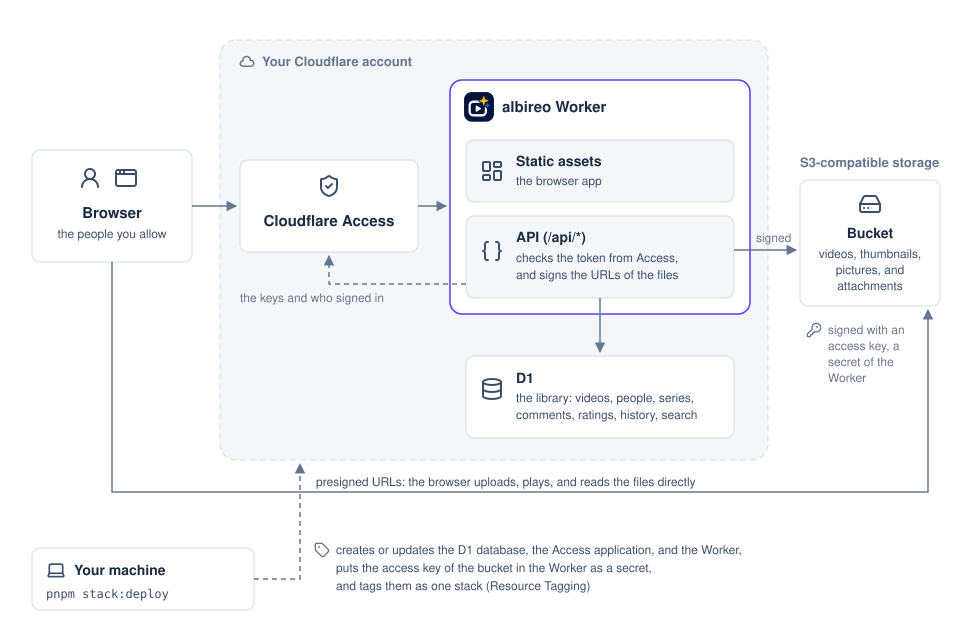

albireo splits the work in two. The Worker answers small requests, and the browser moves the files.

## Architecture in production

The diagram shows albireo in production: the parts and the requests between them. Each arrow points from the part that sends a request.



The diagram has three paths.

1. Every request to your domain goes through Access before it reaches the Worker. This covers the pages of the browser app and the API.
2. The Worker keeps the library in D1, and it signs its own requests to the bucket.
3. The browser uploads videos, thumbnails, pictures, and attachments, and it plays and reads them, directly with presigned URLs.

A presigned URL is a URL that carries its own signature and expiry time.
With one, the browser can read or write one object in the bucket without holding the storage keys.

On your machine, albireo runs without Access and with local copies of D1 and the bucket. [Local development](../../project/development/) describes that setup.

## Parts

albireo uses four parts.

1. The Worker
2. D1
3. The bucket
4. Cloudflare Access

The Worker serves the browser app and the HTTP API.
The browser app is a React single-page app built with Vite, and Cloudflare serves it as static assets.

Only requests to `/api/*` run the Worker code, which uses the Hono framework (cloudflare.config.ts, worker/index.ts).

```ts
// cloudflare.config.ts: the browser app is static assets, and only /api/* runs the Worker
assets: {
  notFoundHandling: "single-page-application",
  runWorkerFirst: ["/api/*"],
},
```

The browser app builds on these libraries (package.json).

- Tailwind CSS v4 for the styles, Radix UI for the menus, dialogs, and sliders, and lucide-react for the icons
- Video.js 10 (@videojs/react) for the player
- react-easy-crop for cropping profile pictures
- react-pdf, @extend-ai/react-pptx, and react-markdown for the previews of attachments

D1 is Cloudflare's serverless SQLite database.
albireo keeps these tables in D1 (migrations/0001_create_videos.sql to migrations/0009_user_language.sql).

- videos: one row per video, with its title, description, size, duration, resolution, thumbnail, uploader, series, and upload state
- users: one row per person, with the email, the display name, the bio, the picture, and the language of the app
- sessions: the Cloudflare Access sessions that albireo saw, for the account page
- series: one row per series, with its title, description, and creator
- watch_history: the videos that each person watched, with the last time
- comments and ratings: what people wrote under videos, and the stars that they gave them
- attachments: the files of each video, with their names, types, and sizes
- video_search: the full-text index of the titles and descriptions

The bucket holds the video files, their thumbnails, the profile pictures, and the attachments (worker/app.ts).

- A video goes to `videos/<ID>/original<extension>`, and its thumbnail to `thumbnails/<ID>.jpg`.
- A profile picture goes to `avatars/<user ID>.jpg`.
- An attachment goes to `attachments/<video ID>/<attachment ID>`.

The Worker signs its requests to the bucket with AWS Signature Version 4, using the aws4fetch library (worker/storage.ts).

Cloudflare Access is a Cloudflare service that signs people in before their requests reach an application.
For each request, Access adds a signed JSON Web Token in the `Cf-Access-Jwt-Assertion` header.

The Worker verifies this token on every `/api/*` request (worker/app.ts).
The check uses the public keys of your Access team and the AUD tag, the Application Audience tag that identifies one Access application (worker/access.ts).

```ts
// worker/access.ts: the Worker fetches the team's public keys from the team domain
keySet = createRemoteJWKSet(new URL("/cdn-cgi/access/certs", teamDomain));
```

## The path of a video

A multipart upload sends one file to the bucket as several parts, then joins the parts into one object.
albireo uploads every video this way.

Upload:

1. The browser asks the Worker to start an upload.
2. The Worker starts a multipart upload in the bucket, and answers with presigned URLs for the parts.
3. The browser sends each part to the bucket with its presigned URL.
4. The browser asks the Worker to finish the upload.
5. The Worker completes the upload in the bucket, and checks the size of the file.

Playback:

1. The browser opens a video, and the Worker answers with a presigned URL for it.
2. The browser reads the video from the bucket with that URL, in byte ranges.

Thumbnails, profile pictures, and attachments take a shorter path: one presigned PUT each, then a commit.
On the commit, the Worker checks that the file is in the bucket before albireo shows it (worker/app.ts).

## Design choices

- Video data never passes through the Worker (worker/storage.ts). The Worker starts and completes uploads and signs URLs, so it never carries the bytes of a video, however large the video is.
- D1 holds the library. The pages read D1, so they never list the bucket.
- albireo stores each file as it is. It does not transcode the file or turn it into HLS (HTTP Live Streaming), a format that splits a video into many small files. Each video stays one object, and no transcoding service is needed.
- Search runs in D1, with SQLite's full-text search FTS5 and its trigram tokenizer (migrations/0006_video_search.sql). A search library in the browser would need the titles and descriptions of every video. The trigram tokenizer finds words inside longer text, so it also works for languages that do not put spaces between words, such as Japanese.
- Previews of attachments run in the browser. The Worker cannot run converters such as LibreOffice, and online viewers would send private files to another company.
- albireo never deletes files from the bucket. Removing a picture or an attachment only unlinks it, so the access key needs no permission to delete.
- The Worker has no workers.dev address and no preview URLs (cloudflare.config.ts: `workersDev: false`, `previewUrls: false`). The only way in is the domain that Access protects.
- Every setting is required, and albireo has no default values (config/settings.ts). A deployment behaves exactly as its settings say.

A video plays if the browser supports its format, such as MP4 with H.264 video and AAC audio.
